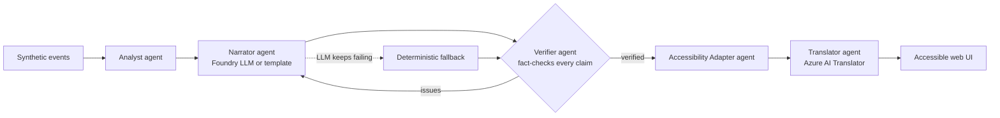

# Pitchside

**Multi-agent, accessible match intelligence from synthetic football event data.**
Built for *Inside the Game: Developer Hackathon* (Microsoft x Premier League).

Football is experienced through sound and sight. Pitchside turns a stream of match events into a
**fact-checked** story, then re-renders that story for how each fan follows the game: captions with
sound cues and vibration for deaf fans, spatial audio description for blind fans, and braille-ready
text for deafblind fans, in multiple languages.

> All clubs, players and events are synthetic and fictional. No real Premier League data is used.

## How it works



| Agent | Role | Technology |
|---|---|---|
| Analyst | Score, xG, momentum windows, key moments (deterministic, so numbers never come from an LLM) | Python |
| Narrator | Writes the recap; every sentence carries structured `claims` | Microsoft Foundry (Azure OpenAI-compatible deployment) |
| Verifier | Checks each claim (minute, player, team, score) against raw events; rejects and returns issues | Python |
| Accessibility Adapter | Renders one verified story per profile: sound cues, plain language, spatial description, haptics, SSML, 40-cell braille text | Python, Azure AI Speech SSML |
| Translator | English, Spanish, French, Hindi, Tamil | Azure AI Translator |
| Orchestrator | Shared state, handoffs, retry with feedback, fallback, per-step trace | Python |

**Failure recovery:** if the LLM returns bad JSON, is down, or states something the Verifier rejects,
the Narrator is retried with the Verifier's issues. After `max_attempts` the deterministic narrator
takes over, so a recap is always produced and always verified. Every step is traced and shown in the UI.

**Offline by default:** with no credentials the whole app runs on deterministic template agents.
Set the variables in `.env.example` to switch on Foundry and Translator.

## Run it

```bash
python -m venv .venv && source .venv/bin/activate
pip install -e ".[dev]"
pytest -q
uvicorn pitchside.api:app --reload      # open http://127.0.0.1:8000
```

Optional Azure config: copy `.env.example` to `.env`, fill it in, and export the variables
(for example `set -a; source .env; set +a`).

## Accessibility features

| Profile | What the user gets |
|---|---|
| Deaf / hard of hearing | Captions with sound cues (`[crowd erupts]`), plain-language wording, vibration patterns, a visual flash on goals (single slow fade, reduced-motion aware) |
| Blind / low vision | Spatial description of each play ("inside the penalty area, right of centre"), live-region announcements, speech, a tone whose pitch rises with chance quality, SSML ready for Azure AI Speech neural voices |
| Deafblind | Plain text wrapped to 40 cells for refreshable braille displays, plus vibration |
| Everyone | Skip link, keyboard navigation, high-contrast mode, larger text, tables with real headers |

The UI is built to follow WCAG practices, but **do not claim conformance until you have tested it**:
run Accessibility Insights and try it with NVDA or VoiceOver.

## Hackathon checklist

- [ ] Public GitHub repo (required)
- [ ] Pitch: what it does, which Microsoft/Azure tech is used, what problem it solves
- [ ] Demo video under 2 minutes, public on YouTube/Vimeo/Facebook Video/Youku, no third-party trademarks or copyrighted music
- [ ] Submit on the Innovation Studio Platform before **Oct 27, 2026, 11:59 PM PT**

## Roadmap / known gaps

- Port the orchestration onto **Microsoft Agent Framework** (agents here are plain Python classes with clear interfaces)
- Use **Azure AI Speech** for real audio (SSML is already generated; the UI currently uses browser speech)
- Host on **Azure Container Apps**; add Cosmos DB or Fabric for match data and state
- Add Foundry evaluations for narration quality and a live event stream (the demo plays a finished match)
- Add a LICENSE file
