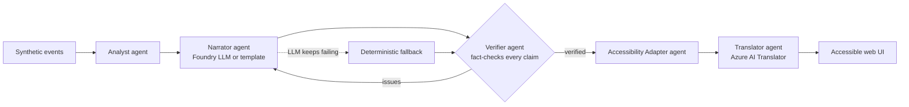
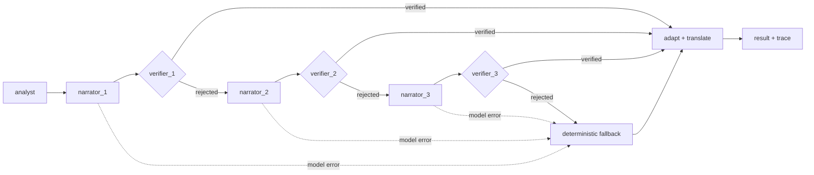

# Pitchside

**Multi-agent, accessible match intelligence from synthetic football event data.**
Built for *Inside the Game: Developer Hackathon* (Microsoft x Premier League).

I am deaf, and I love football, but most of it is delivered through sound and sight. Pitchside turns a stream of match events into a
**fact-checked** story, then re-renders that story for how each fan follows the game: captions with
sound cues and vibration for deaf fans, spatial audio description for blind fans, and braille-ready
text for deafblind fans, in multiple languages.

**Try it:** https://pitchside.calmforest-ffc59cc3.eastus.azurecontainerapps.io/  
**Demo video (under 2 minutes):** https://youtu.be/szCEB5dkeEk

> All clubs, players and events are synthetic and fictional. No real Premier League data is used.

## How it works



| Agent | Role | Technology |
|---|---|---|
| Analyst | Score, xG, momentum windows, key moments, and the evidence for why each moment matters (deterministic, so numbers never come from an LLM) | Python |
| Narrator | Writes the recap; every sentence carries structured `claims` | Microsoft Foundry deployment (`gpt-4.1-mini`), run as a Microsoft Agent Framework `Agent` in the workflow engine |
| Verifier | Checks each claim (minute, player, team, score) and each stated reason against raw events and recomputed evidence; rejects and returns issues | Python |
| Accessibility Adapter | Renders one verified story per profile: sound cues, plain language, spatial description, haptics, SSML, 40-cell braille text | Python, Azure AI Speech SSML |
| Translator | English, Spanish, French, Hindi, Tamil | Azure AI Translator |
| Orchestrator | Shared state, handoffs, retry with feedback, fallback, per-step trace | Plain Python, or a Microsoft Agent Framework workflow (see below) |

**Failure recovery:** if the LLM returns bad JSON, is down, or states something the Verifier rejects,
the Narrator is retried with the Verifier's issues. After `max_attempts` the deterministic narrator
takes over, so a recap is always produced and always verified. Every step is traced and shown in the UI.

## Two settings, eight experiences

Detail level and presentation are independent, so any pair works and every one comes from the same
verified story:

| Setting | Options |
|---|---|
| Detail | **Casual fan** (the short reason a moment matters) or **Tactical analyst** (every reason, with the numbers) |
| Presentation | Standard, deaf or hard of hearing, blind or low vision, deafblind |

"Why it matters" is computed by the Analyst, never by the model: for example "Harbour United are down
to 10 players. Northgate FC took control afterwards: attacking threat 14.5 to 0.5 over the next 15
minutes, against 3.5 to 3.5 before." The Narrator only phrases those reasons. The Verifier checks that
each reason exists in the recomputed analysis, that the evidence figures match, that the wording agrees
with the score state ("takes the lead", "levels the score", and so on), and, at analyst depth, that the
numbers appear in the text.

## Story matches and a check on the Analyst

The generator can write a match around a storyline: a **red-card swing**, a **late comeback**, or a
**dominant but wasteful** side. The storyline is recorded privately as ground truth. The agents never
see it; `storycheck.py` measures whether the Analyst recovers it from the raw events alone, and the
page shows the result.

On 60 seeds per story the Analyst recovered the planted storyline every time, and against the analysis
of an unrelated match the check says "not found" at least 90 percent of the time (the negative control).
**Read this carefully:** the generator guarantees each story's premise is true in the events (for
example, that the side with ten men really is out-attacked afterwards), so this measures the Analyst
against known stories. It is not a general accuracy figure.

## Simulated live feed

A finished synthetic match can be played back minute by minute (`/api/replay`, or "Start simulated
match" in the page). Each step is a full recap built from only the events up to that minute, written
by the built-in agents (no model tokens, English only) and verified like any other. A half-played
match has no final score, so those recaps say "After 40 minutes: ..." and the Verifier enforces that
form. The storyline check is shown at full time only. This is a simulation of a live feed, not a
connection to one.

## Verifier demo

The real model rarely makes a mistake on demand, so the page has a "Verifier demo" selector. It
deliberately corrupts the first draft (a wrong minute or a wrong score), and the agent trace labels it
`INJECTED FAULT (demo, not a model mistake)`. The Verifier is not told; it rejects the draft by
comparing it with the raw events, the Narrator is retried with the reasons, and the corrected draft
passes. The corrupted draft never reaches the reader. The trace also shows the reason for every real
rejection.

**Offline by default:** with no credentials the whole app runs on deterministic template agents.
Set the variables in `.env.example` to switch on Foundry and Translator.

## Two engines, one set of steps

The pipeline steps live in `pipeline_steps.py`. Two engines run them, so both behave the same:

* **Plain Python** (`orchestrator.py`), the default.
* **Microsoft Agent Framework workflow** (`af_workflow.py`), opt-in with `?engine=agent_framework`
  on `/api/recap`. Each role is a workflow executor, the Narrator is a framework `Agent` backed by
  the Foundry deployment, and the Verifier routes with conditional edges:



Retry attempts are unrolled into separate nodes rather than a loop-back edge. If every attempt is
rejected or the model is unavailable, the deterministic narrator takes over, so a verified recap is
always produced.

## Run it

```bash
python -m venv .venv && source .venv/bin/activate      # Windows: .venv\Scripts\activate
pip install -e ".[dev,agent]"                          # "agent" adds Microsoft Agent Framework
pytest -q
uvicorn pitchside.api:app --reload --env-file .env     # open http://127.0.0.1:8000
```

The app runs without any keys. To use Microsoft Foundry, copy `.env.example` to `.env` and fill in
the endpoint, key and **deployment name**, then check the connection:

```bash
python scripts/check_foundry.py          # one small request to your deployment
python scripts/try_llm.py                # plain engine with the real model
python scripts/try_agent_framework.py    # workflow engine with the real model
```

Try the workflow engine through the API: `/api/recap?engine=agent_framework`.

API options for `/api/recap`: `seed`, `profiles`, `language`, `engine`, `depth` (`casual` or
`analyst`), `archetype` (`red_card_swing`, `late_comeback`, `dominant_wasteful`) and `fault`
(`wrong_minute` or `wrong_score`). `/api/replay` takes `seed`, `profiles`, `depth` and `archetype`.

## Deploy to Azure Container Apps

The live demo runs this way, in Azure Container Apps (East US). `scripts/deploy_azure.ps1` builds the image in Azure from the `Dockerfile`, reads your `.env`, stores
the API keys as Container Apps secrets and prints the public URL:

```powershell
az login
.\scripts\deploy_azure.ps1 -ResourceGroup <your-resource-group> -Location eastus
```

**Public-demo guardrails** (`guard.py`, tunable in `.env.example`): repeated requests are answered
from an in-memory cache; each client may make 30 uncached requests a minute; and at most 200 runs an
hour may call Foundry or Translator. Once that budget is spent the app does not turn anyone away: it
answers with the offline template agents (response header `X-Pitchside-Mode: offline-budget`). The
counters live in one process, so the app runs a single replica. With `PITCHSIDE_WARM_CACHE=1`
(on in the Docker image) the app pre-computes the eight demo recaps at start-up, so a first visitor is
served from the cache instead of waiting for the model.

## Accessibility features

| Profile | What the user gets |
|---|---|
| Deaf / hard of hearing | Captions with sound cues (`[crowd erupts]`), plain-language wording, vibration patterns, a visual flash on goals (single slow fade, reduced-motion aware) |
| Blind / low vision | Spatial description of each play ("inside the penalty area, right of centre"), live-region announcements, speech, a tone whose pitch rises with chance quality, SSML ready for Azure AI Speech neural voices |
| Deafblind | Plain text wrapped to 40 cells for refreshable braille displays, plus vibration |
| Everyone | Skip link, keyboard navigation, high-contrast mode, larger text, tables with real headers |

The UI is built to follow WCAG practices, but **do not claim conformance until you have tested it**:
run Accessibility Insights and try it with NVDA or VoiceOver (a first NVDA pass has been done). `scripts/a11y_audit.py` runs automated
checks (structure, labels, tab order, focus, contrast in both themes, reflow at 320px) against a running
Pitchside; it passes, but it is not a substitute for a person using a screen reader.

## Hackathon checklist

- [x] Public GitHub repo (required)
- [x] Working link for judges, free to use until Nov 10 (required): https://pitchside.calmforest-ffc59cc3.eastus.azurecontainerapps.io/
- [x] Pitch: what it does, which Microsoft/Azure tech is used, what problem it solves
- [x] Demo video under 2 minutes, public on YouTube, no third-party trademarks or copyrighted music: https://youtu.be/szCEB5dkeEk
- [ ] Submit on the Innovation Studio Platform before **Oct 27, 2026, 11:59 PM PT**

## Known gaps and roadmap

- Translations are ordinary machine translation on top of the verified English text; only the English
  source is fact-checked. Without Translator keys the app falls back to English.
- The simulated live feed replays a finished match; it is not connected to a live source, and its
  steps are written by the template agents rather than the model.
- The planted-storyline result measures the Analyst against stories the generator guarantees; it is
  not a general accuracy claim.
- The synthetic data has one new event type (red card) beyond the original set. Tackles, turnovers,
  match context and a dataset card are not built.
- No speed or distance metrics: the synthetic data holds event positions, not player tracking, and
  invented numbers would undermine the point of a fact-checked recap. Roadmap only.
- The page passes automated accessibility checks and a first walk-through with NVDA by the author. It
  has not been tested with VoiceOver or a braille display, so no accessibility conformance is claimed.
- Only the recap timeline is translated; page labels, the momentum summary and notes stay in English.
- Not built: a favourite-club setting, Azure AI Speech audio (SSML is generated; the page uses browser
  speech), Foundry evaluations of narration quality, a LICENSE file, and showing the engine choice and
  each workflow step in the page.
