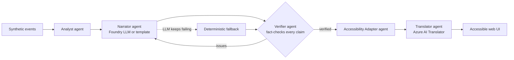
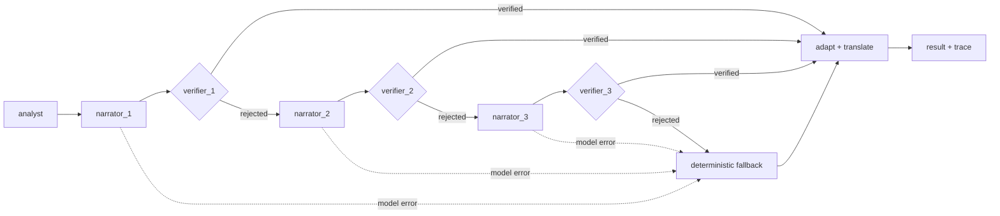

# Pitchside

**Multi-agent, accessible match intelligence from synthetic football event data.**
Built for *Inside the Game: Developer Hackathon* (Microsoft x Premier League).

Football is experienced through sound and sight. Pitchside turns a stream of match events into a
**fact-checked** story, then re-renders that story for how each fan follows the game: captions with
sound cues and vibration for deaf fans, spatial audio description for blind fans, and braille-ready
text for deafblind fans, in multiple languages.

> All clubs, players and events are synthetic and fictional. No real Premier League data is used.

## How it works



| Agent | Role | Technology |
|---|---|---|
| Analyst | Score, xG, momentum windows, key moments (deterministic, so numbers never come from an LLM) | Python |
| Narrator | Writes the recap; every sentence carries structured `claims` | Microsoft Foundry deployment (`gpt-4.1-mini`), run as a Microsoft Agent Framework `Agent` in the workflow engine |
| Verifier | Checks each claim (minute, player, team, score) against raw events; rejects and returns issues | Python |
| Accessibility Adapter | Renders one verified story per profile: sound cues, plain language, spatial description, haptics, SSML, 40-cell braille text | Python, Azure AI Speech SSML |
| Translator | English, Spanish, French, Hindi, Tamil | Azure AI Translator |
| Orchestrator | Shared state, handoffs, retry with feedback, fallback, per-step trace | Plain Python, or a Microsoft Agent Framework workflow (see below) |

**Failure recovery:** if the LLM returns bad JSON, is down, or states something the Verifier rejects,
the Narrator is retried with the Verifier's issues. After `max_attempts` the deterministic narrator
takes over, so a recap is always produced and always verified. Every step is traced and shown in the UI.

**Offline by default:** with no credentials the whole app runs on deterministic template agents.
Set the variables in `.env.example` to switch on Foundry and Translator.

## Two engines, one set of steps

The pipeline steps live in `pipeline_steps.py`. Two engines run them, so both behave the same:

* **Plain Python** (`orchestrator.py`), the default.
* **Microsoft Agent Framework workflow** (`af_workflow.py`), opt-in with `?engine=agent_framework`
  on `/api/recap`. Each role is a workflow executor, the Narrator is a framework `Agent` backed by
  the Foundry deployment, and the Verifier routes with conditional edges:



Retry attempts are unrolled into separate nodes rather than a loop-back edge. If every attempt is
rejected or the model is unavailable, the deterministic narrator takes over, so a verified recap is
always produced.

## Run it

```bash
python -m venv .venv && source .venv/bin/activate      # Windows: .venv\Scripts\activate
pip install -e ".[dev,agent]"                          # "agent" adds Microsoft Agent Framework
pytest -q
uvicorn pitchside.api:app --reload --env-file .env     # open http://127.0.0.1:8000
```

The app runs without any keys. To use Microsoft Foundry, copy `.env.example` to `.env` and fill in
the endpoint, key and **deployment name**, then check the connection:

```bash
python scripts/check_foundry.py          # one small request to your deployment
python scripts/try_llm.py                # plain engine with the real model
python scripts/try_agent_framework.py    # workflow engine with the real model
```

Try the workflow engine through the API: `/api/recap?engine=agent_framework`.

## Deploy to Azure Container Apps

`scripts/deploy_azure.ps1` builds the image in Azure from the `Dockerfile`, reads your `.env`, stores
the API keys as Container Apps secrets and prints the public URL:

```powershell
az login
.\scripts\deploy_azure.ps1 -ResourceGroup pitchside-rg -Location centralindia
```

**Public-demo guardrails** (`guard.py`, tunable in `.env.example`): repeated requests are answered
from an in-memory cache; each client may make 30 uncached requests a minute; and at most 200 runs an
hour may call Foundry or Translator. Once that budget is spent the app does not turn anyone away: it
answers with the offline template agents (response header `X-Pitchside-Mode: offline-budget`). The
counters live in one process, so the app runs a single replica.

## Accessibility features

| Profile | What the user gets |
|---|---|
| Deaf / hard of hearing | Captions with sound cues (`[crowd erupts]`), plain-language wording, vibration patterns, a visual flash on goals (single slow fade, reduced-motion aware) |
| Blind / low vision | Spatial description of each play ("inside the penalty area, right of centre"), live-region announcements, speech, a tone whose pitch rises with chance quality, SSML ready for Azure AI Speech neural voices |
| Deafblind | Plain text wrapped to 40 cells for refreshable braille displays, plus vibration |
| Everyone | Skip link, keyboard navigation, high-contrast mode, larger text, tables with real headers |

The UI is built to follow WCAG practices, but **do not claim conformance until you have tested it**:
run Accessibility Insights and try it with NVDA or VoiceOver.

## Hackathon checklist

- [x] Public GitHub repo (required)
- [ ] Working link for judges, free to use until Nov 10 (required)
- [ ] Pitch: what it does, which Microsoft/Azure tech is used, what problem it solves
- [ ] Demo video under 2 minutes, public on YouTube/Vimeo/Facebook Video/Youku, no third-party trademarks or copyrighted music
- [ ] Submit on the Innovation Studio Platform before **Oct 27, 2026, 11:59 PM PT**

## Roadmap / known gaps

In progress for the submission: "why it matters" explanations computed by the Analyst, a casual fan
or tactical analyst setting independent of the accessibility profile, a simulated live replay of a
match, story archetypes in the synthetic data, and a labelled fault-injection demo of the Verifier.

Known gaps and limits:

- Translations are ordinary machine translation on top of the verified English text; only the English
  source is fact-checked. Without Translator keys the app falls back to English.
- The demo plays a finished match; it is not connected to a live feed.
- No speed or distance metrics: the synthetic data holds event positions, not player tracking, and
  invented numbers would undermine the point of a fact-checked recap. Roadmap only.
- Show the engine choice and each workflow step in the UI (today the engine is selected through the API)
- Use **Azure AI Speech** for real audio (SSML is already generated; the UI currently uses browser speech)
- Add Foundry evaluations for narration quality
- Add a LICENSE file
